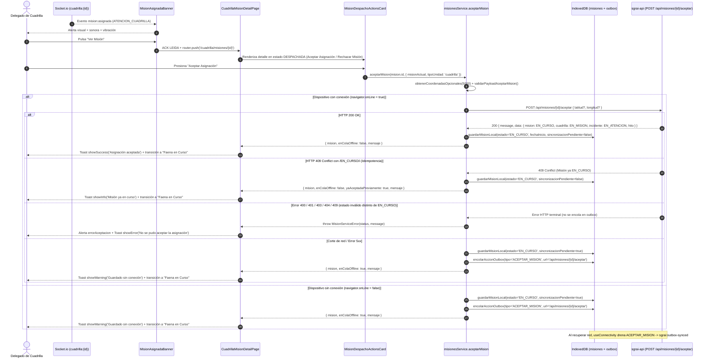

# Plan de Implementación — H40: Aceptar Asignación de Incidente por Delegado de Cuadrilla (`sgrai-pwa`)

## 1. Encabezado y Metadatos

- **Historia de Usuario:** **H40** — Como **Delegado de Cuadrilla**, quiero aceptar la solicitud de asignación a un incidente desde el dispositivo móvil para confirmar que la cuadrilla se hará cargo de los trabajos y notificar a la central de operaciones que la brigada inicia el desplazamiento y asume formalmente la atención de la emergencia.
- **Rol Objetivo:** `DELEGADO_CUADRILLA` (Delegado de Cuadrilla).
- **Permiso RBAC Requerido:** `misiones:terreno:ejecutar` (asignado a `DELEGADO_CUADRILLA` en `sgrai-api` por migración `057_permiso_misiones_terreno_ejecutar.ts`).
- **Repositorio Objetivo:** `sgrai-pwa` (`/home/zetastormy/Development/SGRAI/web-app`).
- **Fuera de Alcance:**
  - `sgrai-api`: La extensión de `POST /api/misiones/{id}/aceptar` para `ATENCION_CUADRILLA`, la transacción atómica Kysely/PostgreSQL (`mision.estado = 'EN_CURSO'`, `fecha_inicio = CURRENT_TIMESTAMP`, `cuadrilla.estado = 'EN_MISION'`, `incidente.estado = 'EN_ATENCION'`, hito `'Asignación Aceptada por Cuadrilla'`), el permiso RBAC y la emisión WebSocket (`incidente:actualizado`, `mision:actualizada`, `cuadrilla:actualizada`) residen en el backend.
  - `sgrai-web`: La transición visual del incidente a `EN_ATENCION` en el tablero Kanban del Encargado corresponde al portal web.
- **Rama de Trabajo:** `feature/h40-cuadrilla-aceptar-asignacion` (creada desde `feature/H68-cierre-mision-cuadrilla`, integrando H43, H68, los componentes compartidos de detalle y el fix de Noto Sans auto-alojada desde `d9ad92e`).

---

## 2. Matriz de Impacto de Cambios de `sgrai-api` hacia `sgrai-pwa`

| # | Cambio en `sgrai-api` | Impacto y Responsabilidad en `sgrai-pwa` |
|---|---|---|
| **1** | **Contrato HTTP compartido (`POST /api/misiones/{id}/aceptar`, `HTTP 200 OK`):** acepta `tipoMision: "ATENCION_CUADRILLA"` con permiso `misiones:terreno:ejecutar`, recibe body opcional `{ latitud, longitud }` (paridad WGS84 o `{}`) y responde `{ message, data: { mision, cuadrilla, patrulla: null, incidente, hito } }` con `mision.estado = "EN_CURSO"`, `mision.fechaInicio`, `cuadrilla.estado = "EN_MISION"`, `incidente.estado = "EN_ATENCION"` e `hito.descripcion = "Asignación Aceptada por Cuadrilla"`. | Generalizar la función de aceptación en `src/services/misionesService.ts` (`aceptarMision` con alias retrocompatible `aceptarMisionPatrulla`), consumiendo `apiClient.POST('/api/misiones/{id}/aceptar', ...)`, capturando GPS no bloqueante (`obtenerCoordenadasOpcionales`), validando con `validarPayloadAceptarMision`, manejando `409 Conflict` idempotente (`/EN_CURSO/i`) y encolando `ACEPTAR_MISION` en IndexedDB `outbox` ante modo offline o falla de red. |
| **2** | **Reutilización de componentes compartidos de detalle (`MisionDetalleShared.tsx` y `MisionDetailLayout.module.css`):** diseño plano, bordes rectos (`0px`), botones `>= 48px` y cero emojis (`lucide-react`). | Extraer `MisionDespachoActionsCard` en `src/components/misiones/MisionDetalleShared.tsx` usando `.actionCard`, `.actionTitle`, `.actionDescription`, `.errorAlert`, `.actionsStack` y `.actionPrimaryButton`. En `src/app/(terreno)/cuadrilla/misiones/[id]/page.tsx`, actualizar `MisionDetalleHeaderCard` (`etiquetaFecha` dinámica `'Inicio de trayecto'` vs `'Despachada'` y `fechaPrincipal={mision.fechaInicio \|\| mision.fechaDespacho}`) y mostrar **`Aceptar Asignación`** junto a **`Rechazar Misión`** (H41) cuando `esDespachada && unidadActiva && esCuadrilla && tienePermisoEjecutar`. |
| **3** | **Alerta de despacho (`mision:asignada`):** payload enriquecido con `cuadrillaId`, `incidenteCodigo`, `incidenteFolio`, `tipoAfectacion`, `direccion` y `prioridad`. | Habilitar `esCuadrilla` en `src/context/NotificacionesTerrenoContext.tsx` y agregar `unirseASalaCuadrilla` / `salirDeSalaCuadrilla` en `src/lib/socket/socketClient.ts` para suscribirse a `cuadrilla:${unidadId}`, procesar alertas con `MisionAsignadaBanner` y navegar a `/cuadrilla/misiones/${alerta.misionId}` al presionar **"Ver Misión"**. |
| **4** | **Notificaciones tipo Toast (`useToastOptional` con `dedupKey`):** ventana de deduplicación de 3s en `src/components/ui/Toast.tsx`. | Homologar los avisos en ambos flujos de aceptación (**Cuadrilla** H40 y **Patrulla** H36): `showSuccess` (`dedupKey: 'aceptar-mision-' + mision.id`), `showWarning` offline (`dedupKey: 'aceptar-mision-offline-' + mision.id`), `showInfo` idempotente `409 EN_CURSO` (`dedupKey: 'aceptar-mision-idemp-' + mision.id`) y `showError` ante `400/401/403/404/409` no idempotente. |
| **5** | **Actualización de especificación OpenAPI (`GET /openapi.json`):** `AceptarMisionResponse.data` incorpora `cuadrilla: { id, nombre, estado, delegacionId } \| null` y `mision.cuadrillaId: string \| null`. | Actualizar `src/types/api-generated.d.ts` en `AceptarMisionResponse` (`cuadrillaId`, `cuadrilla`, `incidente.prioridad`) y comentarios del endpoint `/api/misiones/{id}/aceptar`. |

---

## 3. Diagrama de Secuencia (Tiempo Real y Arquitectura Offline-First)

---

## 4. Desglose por Fases y Verificación

1. **Contratos y Servicios:** `src/types/api-generated.d.ts`, `src/services/misionesService.ts`, `src/hooks/useConnectivity.ts`.
2. **UI Compartida y Vistas de Detalle:** `src/components/misiones/MisionDetalleShared.tsx`, `src/app/(terreno)/cuadrilla/misiones/[id]/page.tsx`, `src/app/(terreno)/patrulla/misiones/[id]/page.tsx`.
3. **Tiempo Real y Alertas de Despacho:** `src/lib/socket/socketClient.ts`, `src/types/notificaciones.ts`, `src/services/notificacionesService.ts`, `src/context/NotificacionesTerrenoContext.tsx`.
4. **QA y Documentación:** Pruebas Vitest/RTL, manual `docs/manuals/H40-aceptar-mision-cuadrilla.md`, `docs/api/contratos-terreno.md`, `docs/design/components.md` y `docs/qa/matrices/matriz-pruebas-terreno.md`.
5. **Verificación final:** `grep -rn "next/font/google" src`, `npx tsc --noEmit`, `npm run lint`, `npm test`, `npm run build`.
