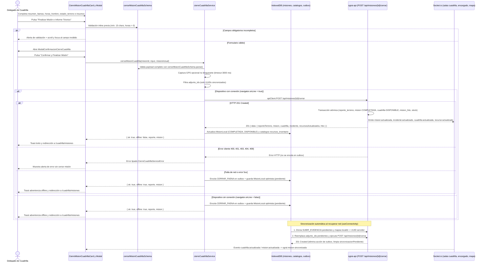

# Plan de Implementación — H68: Cierre de Misión e Informe Técnico Final de Cuadrilla (`sgrai-pwa`)

## 1. Encabezado y Metadatos

- **Historia de Usuario:** **H68** — Completar y enviar el informe técnico final de resolución de la emergencia desde la aplicación de terreno al culminar los trabajos.
- **Rol Objetivo:** `DELEGADO_CUADRILLA` (Delegado de Cuadrilla).
- **Repositorio Objetivo:** `sgrai-pwa` (`/home/zetastormy/Development/SGRAI/web-app`).
- **Fuera de Alcance:**
  - `sgrai-api`: Los cambios backend #1 a #8 ya se encuentran implementados y expuestos en `GET /openapi.json`.
  - `sgrai-web`: La visualización de reportes en `GET /api/incidentes/{id}` (Cambio #5) y el cierre definitivo del incidente por el Encargado (H86) pertenecen al portal web.
- **Rama de Trabajo:** `feature/H68-cierre-mision-cuadrilla`, creada a partir de `feature/h43-adjuntar-evidencia-multimedia` (que ya consolida H35–H39, H41 y H43).
- **Regla de Negocio Crítica:**
  - Al confirmar el informe técnico de cierre (`POST /api/misiones/{id}/cerrar`), la misión transiciona a `COMPLETADA` (`fecha_cierre`) y la cuadrilla pasa inmediatamente a estado `DISPONIBLE` (junto con el personal de dotación sin otras misiones activas), descontando del inventario los materiales consumidos.
  - **El incidente NO se cierra automáticamente** en esta etapa: permanece vigente (ej. `EN_ATENCION`) para evaluación y resolución definitiva del Encargado en el Centro de Mando (**H86**).

---

## 2. Matriz de Mapeo de Cambios de `sgrai-api` hacia `sgrai-pwa`

| # | Cambio en `sgrai-api` | Impacto y Responsabilidad en `sgrai-pwa` |
|---|---|---|
| **1** | **Nuevo endpoint `POST /api/misiones/{id}/cerrar` (`HTTP 201 Created`):** recibe `resumen_faenas` (obligatorio, mín. 15 chars), `materiales_consumidos` (arreglo opcional de `{ recurso_id, cantidad, unidad?, observacion? }`), `horas_hombre` (obligatorio, `> 0 && <= 1000`), `estado_terreno` (`CONTROLADO \| ESTABLE \| FINALIZADO \| REQUIERE_SEGUIMIENTO \| CRITICO \| INACCESIBLE`), campos opcionales (`observaciones`, `danos_estimados`, `requiere_apoyo_adicional`, `requiere_asistencia_social`, `adjunto_ids`, `adjuntos`, `latitud`, `longitud`) y retorna `{ message, data: { reporteTerreno, mision, cuadrilla, incidente, recursosActualizados, hito } }`, con errores `400`, `401`, `403`, `404` y `409`. | Implementar el servicio `cerrarMisionCuadrilla()` en `src/services/cierreCuadrillaService.ts` usando `apiClient.POST('/api/misiones/{id}/cerrar', ...)` (`openapi-fetch`), validación previa con Zod (`cerrarMisionCuadrillaSchema`), captura GPS no bloqueante (`obtenerCoordenadasOpcionales(3000)`), manejo explícito de `400/401/403/404/409` sin encolar errores terminales y encolado offline `CERRAR_FAENA` ante falta de red o fallas `5xx`. |
| **2** | **Actualización de especificación OpenAPI (`GET /openapi.json`):** incorporación del path `POST /api/misiones/{id}/cerrar`, nuevos esquemas `CerrarMisionCuadrillaBody`, `MaterialConsumidoBody`, `MaterialConsumidoDetalle`, `RecursoConsumidoActualizado`, `CerrarMisionCuadrillaResponse` y propiedades opcionales en `ReporteTerrenoDetalle`, `RecursoAsignadoMision`, `MisionDetalleCompleto.evaluaciones` e `IncidenteDetalle.reportesEvaluacionTerreno`. | Regenerar `src/types/api-generated.d.ts` ejecutando `npm run api:generate` contra `sgrai-api`. Derivar los tipos de request/response en `src/types/offline.ts` directamente desde `paths['/api/misiones/{id}/cerrar']['post']` y `paths['/api/misiones/{id}']['get']`, sin definir tipos de API manualmente (`AGENTS.md` §3). |
| **3** | **Cambios de autorización RBAC (Migración `059`):** exigencia del permiso `misiones:terreno:ejecutar` en `POST /api/misiones/{id}/cerrar`, aceptación de `misiones:terreno:ejecutar` en `GET /api/misiones/{id}`, y asignación de `recursos:leer` al rol `DELEGADO_CUADRILLA` (habilitando `GET /api/recursos`). | Exigir `tienePermiso('misiones:terreno:ejecutar')` en `CuadrillaMisionDetailPage` para habilitar la sección de cierre; consultar `GET /api/recursos` cuando el usuario tenga conectividad (degradando a recursos asignados de la misión y caché local si falla o responde `403`); mantener `reportes:crear` para el módulo de evidencia multimedia (H43). |
| **4** | **Extensión de respuesta en `GET /api/misiones/{id}`:** inclusión de `horasHombre` y `materialesConsumidos` en `data.reportesTerreno[]`; nueva etiqueta `"Informe Técnico Final de Cuadrilla (Cierre de Misión)"` cuando `tipoReporte === "REPORTE_CUADRILLA"`; indicadores opcionales `reporteCuadrillaEnviado` y `reporteCuadrillaEnviadoEn` en `data.evaluaciones`; filtrado exclusivo de asignaciones activas (`activo = true`, `desvinculado_en IS NULL`) y campos `esIndividual` y `unidad` en `data.cuadrilla.recursos[]`. | Actualizar `obtenerDetalleMision()` en `src/services/misionesService.ts` para mapear `cuadrillaRecursos` (con `esIndividual` y `unidad`), `estadoCuadrilla`, `fechaCierre`, los reportes `REPORTE_CUADRILLA` (con `horasHombre` y `materialesConsumidos`) y las banderas `reporteCuadrillaEnviado` / `reporteCuadrillaEnviadoEn` hacia `MisionLocal.datosAdicionales` y `offlineQueue`. |
| **5** | **Extensión de respuesta en `GET /api/incidentes/{id}`:** exposición del cierre de cuadrilla en `data.reportesEvaluacionTerreno[]` y `data.ultimoReporte` manteniendo `incidente.estado` sin cierre automático (permanece en `EN_ATENCION` para H86). | **Impacto de código únicamente en `sgrai-web`.** En `sgrai-pwa`, respetar la regla de negocio reflejando en el modal de confirmación (`ModalConfirmacionCierreCuadrilla`) y en los mensajes de éxito que el incidente permanece en evaluación del Centro de Mando para su resolución final (H86). |
| **6** | **Cambios en eventos WebSocket y salas destino (`Socket.io` / Redis):** `mision:actualizada` amplía emisión a `mapa` con `estado: "COMPLETADA"`, `fechaCierre`, `hito: "MISION_COMPLETADA"` y `reporteTerreno`; `incidente:actualizado` se emite a `encargado`, `sala:encargados` y `mapa`; `cuadrilla:actualizada` con `estado: "DISPONIBLE"` amplía emisión a `sala:encargados` y `mapa`; `recurso:actualizado` se emite a `encargado` y `supervisor`. | Agregar suscripción al evento `cuadrilla:actualizada` en `src/hooks/useTerrenoSocket.ts` (despachando `sgrai:mision-sincronizada`, con su `socket.off` en cleanup) y suscribir tanto `CuadrillaMisionDetailPage` como `CuadrillaMisionesPage` a `sgrai:mision-sincronizada` para reflejar cierres en vivo realizados por otros integrantes o desde el servidor. |
| **7** | **Vinculación de evidencia multimedia (integración HU-43):** `POST /api/misiones/{id}/cerrar` acepta `adjunto_ids` y `adjuntos` para asociar archivos ya subidos mediante `POST /api/evidencia/adjuntos` al nuevo `reporte_terreno.id`, y retorna `data.reporteTerreno.id` en el `201` para adjuntos cargados posteriormente. | Enviar en `adjunto_ids` exclusivamente los UUIDs de adjuntos ya sincronizados (excluyendo IDs temporales `local-*`) y enviar `adjuntos` con metadatos. En drenado offline (`useConnectivity.ts`), encadenar `SUBIR_EVIDENCIA` antes de `CERRAR_FAENA` resolviendo cada `adjuntoLocalId` hacia el `id` UUID devuelto por el servidor. Actualizar `datosAdicionales.reporteTerrenoId` con `data.reporteTerreno.id` al recibir `201`. |
| **8** | **Cambios de estado en inventario, cuadrilla y personal:** descuenta `recurso.cantidad_inventario`, ajusta `recurso.cantidad_en_uso` y recalcula `recurso.estado`, actualiza/desvincula `cuadrilla_recurso`, transiciona `cuadrilla.estado` a `DISPONIBLE` y `usuario.estado_operativo` a `disponible` si no hay otras misiones activas. | Actualizar inmediatamente la caché local de misión (`estado: 'COMPLETADA'`, `estadoCuadrilla: 'DISPONIBLE'`, `fechaCierre`) y actualizar el caché local de recursos (`catalogos['recursos_inventario']`) a partir de `data.recursosActualizados` para que consultas posteriores sin red reflejen los saldos vigentes. |

---

## 3. Arquitectura y Diagrama de Secuencia

El flujo de cierre en `sgrai-pwa` opera bajo el paradigma **Offline-First**, validando localmente contra esquemas Zod y tipos OpenAPI antes de despachar la petición HTTP o encolar la mutación en IndexedDB (`outbox`).



---

## 4. Matriz de Consistencia de Diseño e Implementación: Patrulla (H39) vs. Cuadrilla (H68)

| Dimensión | Implementación Existente — Patrulla (H39) | Implementación Homologada — Cuadrilla (H68) | Diferencias Funcionales Obligatorias |
|---|---|---|---|
| **Ruta y Layout Ancho Completo** | `src/app/(terreno)/patrulla/misiones/[id]/page.tsx` incluida en `RUTAS_ANCHO_COMPLETO` (`src/app/(terreno)/layout.tsx`). | `src/app/(terreno)/cuadrilla/misiones/[id]/page.tsx` agregando `/^\/cuadrilla\/misiones\/[^/]+\/?$/` a `RUTAS_ANCHO_COMPLETO` en `src/app/(terreno)/layout.tsx`. | Ninguna en geometría móvil; se unifica el ancho completo y el `topBar` teal oscuro `#14505A`. |
| **Estilos de Página de Detalle** | `PatrullaDetailPage.module.css` (`topBar` `#14505A`, `missionHeader` con `border-top: 4px solid var(--color-accent-mint)`, `evaluationFormsSection`, `SeccionDesplegable`). | Homogeneizar `CuadrillaDetailPage.module.css` adoptando `topBar` `#14505A`, `missionHeader` con borde superior mint, tarjeta de estado activo de cuadrilla y `evaluationFormsSection` con `SeccionDesplegable`, manteniendo clases existentes (`dispatchCard`, `rejectedInfoBox`) para H41. | Preservar `CargaEvidenciaCard` inmediatamente visible en `EN_CURSO` sin ocultarla tras un acordeón cerrado (ver Riesgo #4). |
| **Componentes Base de Reporte** | `ReporteTerrenoBase.tsx` (`AlertaFeedbackReporte`, `BloqueFormularioReporte`, `CampoResumenReporte`, `ResumenReporteTerreno`, `formatearAutorReporte`). | Reutilización directa de los mismos 4 componentes y del formateador de autoría `formatearAutorReporte` desde `src/components/misiones/ReporteTerrenoBase.tsx`. | Sin duplicación de estilos ni tarjetas de resumen. |
| **Componente Formulario** | `EvaluacionReporteCierreCard.tsx` + `.module.css` (bloques numerados, contadores de caracteres, controles táctiles `>= 48px`, `border-radius: 0px`, solo `lucide-react`). | `CierreMisionCuadrillaCard.tsx` + `.module.css` siguiendo el mismo patrón visual Flat UI, Noto Sans, esquinas rectas a `0px`, `role="switch"` y contadores de caracteres. | Campos de H68: `resumen_faenas` (`>= 15` chars), `horas_hombre` (`> 0 && <= 1000`), `estado_terreno` (obligatorio, 6 opciones), `materiales_consumidos` (lista dinámica opcional), `requiere_apoyo_adicional`, `requiere_asistencia_social`, `danos_estimados`, `observaciones`, resumen de adjuntos H43. No incluye `dictamen` ni `personas_afectadas`. |
| **Modal de Confirmación** | `ModalConfirmacionReporteCierre.tsx` basado en `ConfirmModal` (`variante="teal"`, `tamano="md"`) + `ConfirmacionResumen`. | `ModalConfirmacionCierreCuadrilla.tsx` basado en `ConfirmModal` (`variante="teal"`, `tamano="md"`) + `ConfirmacionResumen`, `ConfirmacionResumenFila`, `ConfirmacionResumenJustificacion`. | Muestra estado final del terreno (`Chip`), horas hombre, desglose de materiales consumidos, evidencias vinculadas, escalamientos y nota indicando que el incidente continúa abierto para H86. |
| **Validación Zod** | `src/lib/validations/reporteVerificacion.ts` (`crearReporteVerificacionSchema`). | `src/lib/validations/cierreCuadrilla.ts` (`cerrarMisionCuadrillaSchema`, `materialConsumidoSchema`). | `RESUMEN_FAENAS_MIN = 15` (vs. 10 en H39); `estado_terreno` obligatorio con 6 estados incluyendo `REQUIERE_SEGUIMIENTO`; `horas_hombre` obligatorio (`> 0 && <= 1000`); validación de unicidad de `recurso_id` en materiales. |
| **Servicio HTTP + Offline** | `src/services/reporteVerificacionService.ts` (`obtenerReporteVerificacionMision`, `enviarReporteVerificacionTerreno`). | `src/services/cierreCuadrillaService.ts` (`obtenerReporteCierreCuadrillaMision`, `obtenerRecursosDisponiblesCuadrilla`, `cerrarMisionCuadrilla`) usando `apiClient.POST` (`openapi-fetch`) según `AGENTS.md` §3. | Endpoint `POST /api/misiones/{id}/cerrar`, outbox tipo `'CERRAR_FAENA'`, propiedad `adjunto_ids` (snake_case), actualización de stock local y caché `recursos_inventario`. |
| **Permisos RBAC** | `reportes:crear` / `misiones:terreno:verificar`. | `misiones:terreno:ejecutar` (cierre), `recursos:leer` (catálogo de insumos en `GET /api/recursos`), `reportes:crear` (evidencia H43). | Separación explícita entre permiso de ejecución de faena (`misiones:terreno:ejecutar`) y carga de adjuntos (`reportes:crear`). |
| **Feedback y Navegación Post-Envío** | `useToastOptional()` (`showSuccess` / `showWarning`), `actualizarPendientes()` y `router.push('/patrulla/misiones')`. | `useToastOptional()` (`showSuccess` / `showWarning`), `actualizarPendientes()` y `router.push('/cuadrilla/misiones')`. | Mismo patrón de retorno seguro a la bandeja operativa. |

---

## 5. Desglose Detallado por Fases

### Fase 1 — Contratos OpenAPI, Etiquetas de Lenguaje Natural y Tipos Offline

1. **Regeneración de contratos OpenAPI (`src/types/api-generated.d.ts`)**
   - Con `sgrai-api` en ejecución (con la migración `059` y los cambios H68 activos), ejecutar:
     ```bash
     npm run api:generate
     ```
   - Verificar que el archivo generado incorpore:
     - Path `"/api/misiones/{id}/cerrar"` (`post`) con sus respuestas `201`, `400`, `401`, `403`, `404`, `409`, `500`.
     - Esquemas `CerrarMisionCuadrillaBody`, `MaterialConsumidoBody`, `MaterialConsumidoDetalle`, `RecursoConsumidoActualizado`, `CerrarMisionCuadrillaResponse`.
     - Propiedades actualizadas en `GET /api/misiones/{id}`: `horasHombre`, `materialesConsumidos`, `tipoReporte` (`REPORTE_CUADRILLA`) y `etiquetaReporte` en `reportesTerreno[]`; `reporteCuadrillaEnviado` y `reporteCuadrillaEnviadoEn` en `evaluaciones`; `esIndividual` y `unidad` en `cuadrilla.recursos[]`.

2. **Etiquetas de lenguaje natural (`src/lib/utils/labels.ts`)**
   - Agregar `REQUIERE_SEGUIMIENTO` al diccionario `ETIQUETAS_ESTADO_TERRENO`:
     ```ts
     export const ETIQUETAS_ESTADO_TERRENO: Record<string, string> = {
       CRITICO: 'Crítico',
       ESTABLE: 'Estable',
       INACCESIBLE: 'Inaccesible',
       CONTROLADO: 'Controlado',
       FINALIZADO: 'Finalizado',
       REQUIERE_SEGUIMIENTO: 'Requiere seguimiento',
     };
     ```
   - Asegurar que ningún enum crudo en mayúsculas se muestre en la interfaz (regla UX de `labels.ts`).

3. **Variantes semánticas de Chip (`src/lib/utils/chipVariants.ts`)**
   - Añadir la función exportada `obtenerVarianteChipEstadoTerreno(estado?: string | null): ChipVariant`:
     - `'FINALIZADO'`, `'CONTROLADO'` -> `'success'`
     - `'ESTABLE'` -> `'info'`
     - `'REQUIERE_SEGUIMIENTO'` -> `'warning'`
     - `'CRITICO'`, `'INACCESIBLE'` -> `'danger'`
     - `default` -> `'neutral'`

4. **Tipos locales y derivados OpenAPI (`src/types/offline.ts`)**
   - Confirmar que `'CERRAR_FAENA'` ya forma parte de `AccionOutboxTipo`.
   - Derivar los contratos HTTP estrictamente desde `paths` en `src/types/api-generated.d.ts`:
     - `CerrarMisionCuadrillaPayload`: `NonNullable<paths['/api/misiones/{id}/cerrar']['post']['requestBody']>['content']['application/json']`
     - `CerrarMisionCuadrillaResponseData`: `paths['/api/misiones/{id}/cerrar']['post']['responses'][201]['content']['application/json']['data']`
     - `MaterialConsumidoPayload`: `NonNullable<CerrarMisionCuadrillaPayload['materiales_consumidos']>[number]`
   - Definir los tipos e interfaces locales de estado y formulario:
     - `EstadoTerrenoCierreCuadrilla`: `'CONTROLADO' | 'ESTABLE' | 'FINALIZADO' | 'REQUIERE_SEGUIMIENTO' | 'CRITICO' | 'INACCESIBLE'`
     - `RecursoAsignadoCuadrillaLocal`: `{ id: string; nombre: string; tipo: string; cantidadAsignada: number; esIndividual?: boolean; unidad?: string | null }`
     - `RecursoCatalogoConsumible`: `{ id: string; nombre: string; tipo: string; unidad?: string | null; cantidadDisponible: number; cantidadAsignada?: number; esIndividual: boolean; asignadoACuadrilla: boolean; estado?: string }`
     - `MaterialConsumidoFormItem`: `{ recurso_id: string; nombre?: string; cantidad: number; unidad?: string; observacion?: string }`
     - `CierreMisionCuadrillaForm`: `{ resumen_faenas: string; horas_hombre: number; estado_terreno: EstadoTerrenoCierreCuadrilla; materiales_consumidos: MaterialConsumidoFormItem[]; danos_estimados: string; observaciones: string; requiere_apoyo_adicional: boolean; requiere_asistencia_social: boolean; adjunto_ids: string[]; adjuntos: AdjuntoReportePreliminar[] }`
     - `ReporteCierreCuadrillaLocal`: extiende `CierreMisionCuadrillaForm` con `id?: string`, `misionId: string`, `etiquetaReporte?: string`, `evaluador?: EvaluadorReporteTerreno`, `creadoEn: string`, `sincronizado: boolean`.

---

### Fase 2 — Esquema de Validación Zod (`src/lib/validations/cierreCuadrilla.ts`)

Crear `src/lib/validations/cierreCuadrilla.ts` homologado con `src/lib/validations/reporteVerificacion.ts` y `src/lib/validations/misiones.ts`:

1. **Constantes exportadas:**
   - `ESTADOS_TERRENO_CUADRILLA = ['FINALIZADO', 'CONTROLADO', 'ESTABLE', 'REQUIERE_SEGUIMIENTO', 'CRITICO', 'INACCESIBLE'] as const`
   - `RESUMEN_FAENAS_MIN = 15`
   - `TEXTAREA_MAX = 2000`
   - `HORAS_HOMBRE_MAX = 1000`
   - `VALORES_INICIALES_CIERRE_CUADRILLA: CierreMisionCuadrillaForm` (con `estado_terreno: 'FINALIZADO'`, `horas_hombre: 1`, `materiales_consumidos: []`, `requiere_apoyo_adicional: false`, `requiere_asistencia_social: false`, `adjunto_ids: []`, `adjuntos: []`).

2. **Esquemas Zod:**
   - `materialConsumidoSchema`:
     - `recurso_id`: `z.string().uuid('Seleccione un material o recurso válido.')`
     - `cantidad`: `z.number({ message: 'La cantidad consumida debe ser un número positivo.' }).finite('La cantidad debe ser un valor numérico válido.').positive('La cantidad consumida debe ser mayor a 0.')`
     - `unidad`: `z.string().trim().max(50, 'La unidad no puede superar los 50 caracteres.').optional()`
     - `observacion`: `z.string().trim().max(300, 'La observación del material no puede superar los 300 caracteres.').optional()`
   - `cerrarMisionCuadrillaSchema`:
     - `resumen_faenas`: `z.string({ message: 'El resumen de faenas ejecutadas es obligatorio.' }).trim().min(RESUMEN_FAENAS_MIN, ...).max(TEXTAREA_MAX, ...)`
     - `horas_hombre`: `z.number({ message: 'Las horas hombre son obligatorias.' }).finite(...).positive('Las horas hombre deben ser mayores a 0.').max(HORAS_HOMBRE_MAX, 'Las horas hombre no pueden superar las 1000 horas.')`
     - `estado_terreno`: `z.enum(ESTADOS_TERRENO_CUADRILLA, { message: 'Seleccione un estado final del terreno válido.' })`
     - `materiales_consumidos`: `z.array(materialConsumidoSchema).max(50, ...).optional().default([])`
     - `observaciones`: `z.string().trim().max(TEXTAREA_MAX, ...).optional().default('')`
     - `danos_estimados`: `z.string().trim().max(TEXTAREA_MAX, ...).optional().default('')`
     - `requiere_apoyo_adicional`: `z.boolean().default(false)`
     - `requiere_asistencia_social`: `z.boolean().default(false)`
     - `adjunto_ids`: `z.array(z.string().uuid('Cada identificador de adjunto debe ser un UUID válido.')).max(20).optional().default([])`
     - `adjuntos`: `z.array(adjuntoReporteSchema).max(20).optional().default([])` (reutilizando `adjuntoReporteSchema` exportado desde `src/lib/validations/reporteVerificacion.ts`)
     - `latitud` / `longitud`: opcionales (`finite`, rango `[-90, 90]` / `[-180, 180]`), validadas mediante `.superRefine` como par completo (si se informa una, exigir la otra) e impedir `recurso_id` duplicados en `materiales_consumidos`.
   - Exportar tipos `CerrarMisionCuadrillaInput` (`z.input<typeof cerrarMisionCuadrillaSchema>`) y `CerrarMisionCuadrillaValidado` (`z.output<typeof cerrarMisionCuadrillaSchema>`).

---

### Fase 3 — Persistencia Offline, Servicio de Cierre, Outbox y WebSocket

1. **Caché de evaluaciones y reportes (`src/services/offlineQueue.ts`)**
   - Ampliar `CLAVES_EVALUACION_CACHEABLES` incorporando:
     - `'reporteCuadrilla'`
     - `'reporteCuadrillaEnviado'`
     - `'reporteCuadrillaEnviadoEn'`
     - `'cuadrillaRecursos'`
     - `'fechaCierre'`
   - Actualizar `tieneDatosEvaluacion()` para considerar `datos.reporteCuadrillaEnviado || datos.reporteCuadrilla`.
   - Actualizar `fusionarDatosAdicionalesMision()` para preservar `reporteCuadrillaEnviado === true` y `cuadrillaRecursos` cuando la respuesta remota aún no haya reflejado el cambio local pendiente.

2. **Sincronización y detalle de misiones (`src/services/misionesService.ts`)**
   - **Protección optimista ante cierres offline pendientes:**
     - En `sincronizarMisiones()` y `obtenerDetalleMision()`, reemplazar la condición actual de `mantenerOptimista`:
       - Además de `previa?.sincronizacionPendiente && item.estado === 'DESPACHADA'`, proteger `previa?.sincronizacionPendiente && previa.estado === 'COMPLETADA' && (d.estado === 'EN_CURSO' || d.estado === 'EN_TERRENO' || d.estado === 'DESPACHADA')` para evitar que un polling o recarga antes de drenar el `outbox` revierta el estado local optimista a `EN_CURSO`.
   - **Mapeo extendido de `GET /api/misiones/{id}` en `obtenerDetalleMision()`:**
     - Extraer `reportesCuadrillaRemotos = reportesRemotos.filter((r) => r.tipoReporte === 'REPORTE_CUADRILLA')` y tomar `ultimoReporteCuadrillaRemoto`.
     - Mapear `cuadrillaRecursos` desde `d.cuadrilla?.recursos` conservando `id`, `nombre`, `tipo`, `cantidadAsignada`, `esIndividual` y `unidad`.
     - Guardar en `datosBaseMision`:
       - `estadoCuadrilla`: `d.cuadrilla?.estado`
       - `cuadrillaRecursos`: arreglo mapeado desde `d.cuadrilla?.recursos` (respaldado por `datosPrevios.cuadrillaRecursos` si viene indefinido)
       - `fechaCierre`: `d.fechaCierre ?? (datosPrevios.fechaCierre as string | null | undefined) ?? null`
       - `reporteCuadrillaEnviado`: `Boolean(evalRemota?.reporteCuadrillaEnviado) || reportesCuadrillaRemotos.length > 0 || Boolean(datosPrevios.reporteCuadrillaEnviado)`
       - `reporteCuadrillaEnviadoEn`: `evalRemota?.reporteCuadrillaEnviadoEn ?? ultimoReporteCuadrillaRemoto?.creadoEn ?? ...`
       - `reporteTerrenoId`: priorizar `ultimoReporteCuadrillaRemoto?.id ?? ultimoReporteCierreRemoto?.id ?? (reportesRemotos.length > 0 ? reportesRemotos[0].id : undefined)` para que adjuntos posteriores en H43 se vinculen directamente al informe final cuando aplique.

3. **Nuevo servicio `src/services/cierreCuadrillaService.ts`**
   - Definir clase `CierreCuadrillaServiceError` con `statusCode: number`.
   - Definir constante `CLAVE_CATALOGO_RECURSOS = 'recursos_inventario'`.
   - **`obtenerReporteCierreCuadrillaMision(mision?: MisionLocal | null): ReporteCierreCuadrillaLocal | null`**
     - Prioriza el elemento de `mision.datosAdicionales.reportesTerreno` con `tipoReporte === 'REPORTE_CUADRILLA'` (ordenado por `creadoEn` descendente), extrayendo `resumenTecnico` -> `resumen_faenas`, `horasHombre` -> `horas_hombre`, `estadoTerreno` -> `estado_terreno`, `materialesConsumidos` -> `materiales_consumidos`, `danosEstimados`, `observaciones`, `requiereApoyoAdicional`, `requiereAsistenciaSocial`, `etiquetaReporte`, `adjuntos` y `evaluador`.
     - Si no existe registro remoto, retorna `mision.datosAdicionales.reporteCuadrilla` como respaldo local/offline.
   - **`obtenerRecursosDisponiblesCuadrilla(misionActual?: MisionLocal | null): Promise<RecursoCatalogoConsumible[]>`**
     - Fuente primaria: `misionActual?.datosAdicionales?.cuadrillaRecursos` (recursos ya asignados a la cuadrilla, marcados `asignadoACuadrilla: true`).
     - Fuente secundaria online (`navigator.onLine !== false`): consulta `apiClient.GET('/api/recursos', { params: { query: { limit: 100, esIndividual: false } } })`, guarda en IndexedDB (`guardarCatalogoLocal(CLAVE_CATALOGO_RECURSOS, ...)`) y combina sin duplicar por `id`, dejando primero los recursos asignados a la cuadrilla y filtrando materiales consumibles (`esIndividual === false`). Si el backend responde `403` o falla la red, lee `obtenerCatalogoLocal(CLAVE_CATALOGO_RECURSOS)` y lo combina con los recursos asignados de la misión sin bloquear el formulario.
   - **`cerrarMisionCuadrilla(misionId, input, misionActual?, adjuntosPendientesLocalIds?)`**
     - Valida el formulario mediante `cerrarMisionCuadrillaSchema.parse(input)`.
     - Captura coordenadas GPS opcionales de forma no bloqueante (`obtenerCoordenadasOpcionales(3000)`) si no fueron entregadas explícitamente.
     - Construye el payload estricto del tipo `CerrarMisionCuadrillaPayload` para `sgrai-api` (incluyendo solo UUIDs sincronizados en `adjunto_ids`, excluyendo IDs temporales `local-*`; y limpiando campos opcionales vacíos).
     - **Flujo Online (`navigator.onLine !== false`):**
       - Ejecuta `apiClient.POST('/api/misiones/{id}/cerrar', { params: { path: { id: misionId } }, body: payloadApi })`.
       - Si responde `201 OK` (`!error && data?.data`):
         - Construye `ReporteCierreCuadrillaLocal` con `id: data.data.reporteTerreno.id`, `sincronizado: true`, `evaluador` remoto o de sesión.
         - Actualiza `MisionLocal` en IndexedDB (`estado: data.data.mision.estado || 'COMPLETADA'`, `sincronizacionPendiente: false`, `actualizadoEn`, `datosAdicionales`: `estadoCuadrilla: data.data.cuadrilla?.estado || 'DISPONIBLE'`, `estadoIncidente: data.data.incidente?.estado || 'EN_ATENCION'`, `fechaCierre: data.data.mision.fechaCierre`, `reporteTerrenoId: data.data.reporteTerreno.id`, `reporteCuadrillaEnviado: true`, `reporteCuadrillaEnviadoEn`, `reporteCuadrilla`, `reportesTerreno`).
         - Actualiza el catálogo local `recursos_inventario` aplicando los nuevos `cantidadInventario`, `cantidadEnUso`, `cantidadDisponible` y `estado` de `data.data.recursosActualizados`.
         - Retorna `{ ok: true, offline: false, reporte, mision: misionActualizada, data: data.data, mensaje }`.
       - Si responde `401`: llama `handleUnauthorizedSession()` y arroja `CierreCuadrillaServiceError(401, ...)`.
       - Si responde `400`, `403`, `404` o `409`: **no encola en outbox**; en `409` intenta refrescar `obtenerDetalleMision(misionId)` en segundo plano y arroja `CierreCuadrillaServiceError(status, msgServidor)`.
       - Si responde `5xx` o hay error de red (`TypeError` / falla de `fetch`): deriva al flujo offline.
     - **Flujo Offline:**
       - Construye `ReporteCierreCuadrillaLocal` (`sincronizado: false`) y actualiza `MisionLocal` optimistamente (`estado: 'COMPLETADA'`, `sincronizacionPendiente: true`, `estadoCuadrilla: 'DISPONIBLE'`, `reporteCuadrillaEnviado: true`).
       - Encola en IndexedDB `outbox` (`encolarAccionOutbox`) con `tipo: 'CERRAR_FAENA'`, `url: '/api/misiones/${misionId}/cerrar'`, `metodo: 'POST'` y `payload` (incluyendo metadato interno `_adjuntosPendientesLocalIds` cuando existan evidencias locales sin sincronizar aún).
       - Retorna `{ ok: true, offline: true, reporte, mision: misionActualizada, mensaje }`.

4. **Sincronización de cola offline (`src/hooks/useConnectivity.ts`)**
   - Dentro de `sincronizar()`, instanciar un mapa en memoria `adjuntosSincronizadosMap = new Map<string, AdjuntoLocal>()` al iniciar el ciclo sobre `sincronizarColaOutbox`.
   - Al procesar `accion.tipo === 'SUBIR_EVIDENCIA'` con éxito: guardar `adjuntosSincronizadosMap.set(evPayload.adjuntoLocalId, adjuntoDefinitivo)` además de `reemplazarAdjuntoLocalEnMision(...)`.
   - Antes de ejecutar `fetch` cuando `accion.tipo === 'CERRAR_FAENA'`:
     - Clonar `accion.payload`, extraer y eliminar la clave interna `_adjuntosPendientesLocalIds` para no enviarla en el JSON hacia la API.
     - Si existen IDs locales en `_adjuntosPendientesLocalIds` (o `local-*` en `adjuntos`), resolver aquellos ya sincronizados en `adjuntosSincronizadosMap` agregando sus `id` UUID a `adjunto_ids` y actualizando `adjuntos`.
   - Al recibir respuesta para `accion.tipo === 'CERRAR_FAENA'`:
     - Si `esExito`: parsear `bodyJson?.data` y actualizar `MisionLocal` en IndexedDB con `estado: 'COMPLETADA'`, `sincronizacionPendiente: false`, `fechaCierre`, `estadoCuadrilla: 'DISPONIBLE'`, `reporteCuadrillaEnviado: true`, `reporteTerrenoId: bodyJson?.data?.reporteTerreno?.id`.
     - Si `esConflictoTerminal || esErrorIrrecuperable`: limpiar `sincronizacionPendiente: false` y llamar `obtenerDetalleMision(misionId)` para reconciliar con el estado real del backend.

5. **WebSockets en tiempo real (`src/hooks/useTerrenoSocket.ts`)**
   - Registrar `socket.on('cuadrilla:actualizada', manejarSincronizacionMision)` dentro del `useEffect` y su correspondiente `socket.off('cuadrilla:actualizada', manejarSincronizacionMision)` en la función de limpieza, manteniendo consistencia con `patrulla:actualizada`.

---

### Fase 4 — Componentes UI Flat de Terreno

Todos los componentes nuevos deben respetar estrictamente `AGENTS.md` §2 y `GEMINI.md` §3–§4: cero emojis, iconografía exclusiva con `lucide-react`, bordes rectos (`border-radius: var(--radius-none, 0px)`), cero sombras, alto contraste, Noto Sans y objetivos táctiles mínimos de `48px` (`min-height: 48px`).

1. **`src/components/misiones/CierreMisionCuadrillaCard.tsx` y `CierreMisionCuadrillaCard.module.css`**
   - **Props:**
     - `misionActual: MisionLocal`
     - `adjuntosMision?: AdjuntoLocal[]`
     - `usuarioActualId?: string`
     - `deshabilitado?: boolean`
     - `onCierreEnviado?: (resultado: ResultadoCierreCuadrilla) => void`
     - `onIrAEvidencia?: () => void`
   - **Estado de Solo Lectura (`yaEnviado`):**
     - Renderiza `<ResumenReporteTerreno>` (de `ReporteTerrenoBase.tsx`) con `testId="resumen-cierre-cuadrilla"`, `titulo="Informe Técnico Final de Cuadrilla (Cierre de Misión)"`, `chip={<Chip variant={obtenerVarianteChipEstadoTerreno(estadoTerreno)} size="sm">{formatearEstadoTerreno(estadoTerreno)}</Chip>}`, y `registradoPor={formatearAutorReporte(reporteExistente?.evaluador, fechaCierre, 'Delegado de Cuadrilla')}`.
     - Despliega `CampoResumenReporte` para: Resumen de faenas ejecutadas (`esBloqueTexto`), Horas hombre invertidas (`${horas} h`), Estado final del terreno, Materiales e insumos consumidos (lista legible con cantidad, unidad y observación, o texto `"Sin materiales consumidos registrados"`), Daños materiales estimados (si aplica), Observaciones generales (si aplica), Apoyo adicional y Asistencia Social (Ficha FIBE).
   - **Estado Editable (5 bloques numerados usando `<BloqueFormularioReporte>`):**
     1. **1. Resumen de Faenas Ejecutadas:** `<Textarea>` obligatorio (`resumen_faenas`, `rows={4}`, `maxLength={2000}`, `requiredIndicator`), con contador dinámico (`resumenLimpio.length / 2000`, clases `counterValid` / `counterInvalid`) y regla visible `Mínimo 15 caracteres`.
     2. **2. Horas Hombre y Estado Final del Terreno:**
        - **Horas hombre invertidas (`horas_hombre`):** Controles táctiles `>= 48px` (`-0.5`, input numérico `type="number" min={0.5} max={1000} step={0.5} inputMode="decimal"`, `+0.5`) más atajos táctiles rápidos (`1 h`, `2 h`, `4 h`, `8 h`) y texto explicativo (`Cantidad de integrantes x horas de faena`).
        - **Estado final del terreno (`estado_terreno`):** Grupo `role="radiogroup"` en grilla de botones planos (`1 col` móvil / `2 cols` desde `520px`, `min-height: 56px`) cubriendo los 6 valores (`FINALIZADO`, `CONTROLADO`, `ESTABLE`, `REQUIERE_SEGUIMIENTO`, `CRITICO`, `INACCESIBLE`) con título en lenguaje natural (`formatearEstadoTerreno`) y breve descripción operativa. Si se selecciona `REQUIERE_SEGUIMIENTO`, `CRITICO` o `INACCESIBLE`, mostrar aviso de nota recomendando detallar acciones pendientes.
     3. **3. Materiales e Insumos Consumidos (Opcional):**
        - Carga asíncrona al montar mediante `obtenerRecursosDisponiblesCuadrilla(misionActual)`.
        - Si la cuadrilla tiene equipos individuales asignados (`esIndividual === true`), mostrar nota informativa aclarando que vehículos/equipos retornables no se descuentan como insumos consumibles.
        - Por cada fila agregada: `<Select>` de material (priorizando los asignados a la cuadrilla, deshabilitando recursos ya añadidos en otra fila), stepper táctil `-` / input decimal / `+` (`48px`), `<Input>` de unidad (autocompletado desde `recurso.unidad`) y `<Input>` opcional de observación, más botón eliminar fila (`Trash2`, `48x48px`).
        - Advertencia visual no bloqueante si `cantidad` excede la cantidad asignada/disponible reportada en caché.
        - Botón táctil `<Button type="button" variant="outline" size="md" icon={<Plus size={18} />}>Agregar material consumido</Button>`.
     4. **4. Observaciones, Daños y Escalamientos:**
        - `<Textarea>` opcionales para `danos_estimados` y `observaciones`.
        - Dos interruptores táctiles planos (`role="switch"`, `min-height: 52px`, estilo `fibeSwitchBtn` homologado con H39):
          - `Requiere apoyo adicional o seguimiento operativo` (`requiere_apoyo_adicional`)
          - `Requiere Asistencia Social (Levantamiento Ficha FIBE)` (`requiere_asistencia_social`)
     5. **5. Evidencia Multimedia Vinculada (H43):**
        - Panel informativo leyendo `adjuntosMision`: muestra total de archivos ya cargados, cuántos están **sincronizados** (se vincularán vía `adjunto_ids`) y cuántos están **pendientes offline** (se vincularán al sincronizar la cola), con botón opcional de desplazamiento hacia la tarjeta de Evidencia Multimedia (`onIrAEvidencia`) sin renderizar una segunda instancia de `<CargaEvidenciaCard />`.
   - **Validación y Envío:**
     - Al hacer submit (`handlePreConfirmar`), validar `resumen_faenas` (`>= 15` chars), `horas_hombre` (`> 0 && <= 1000`), y que no haya filas de materiales con `recurso_id` vacío o `cantidad <= 0`. Si hay error, fijar `errorValidacion` y ejecutar `scrollIntoView` + `focus()` sobre el campo inválido (patrón commit `ab760b9`).
     - Botón principal `<Button type="submit" variant="primary" size="lg" fullWidth loading={guardando} disabled={deshabilitado || guardando} icon={<CheckCircle size={18} />}>Finalizar Misión e Informe Técnico</Button>`.

2. **`src/components/misiones/ModalConfirmacionCierreCuadrilla.tsx` y `ModalConfirmacionCierreCuadrilla.module.css`**
   - Implementado sobre `<ConfirmModal variante="teal" tamano="md" titleId="modal-cierre-cuadrilla-titulo" titulo="Confirmar Cierre de Misión e Informe Técnico" textoConfirmar="Confirmar y Finalizar Misión" textoCargando="Enviando informe..." textoCancelar="Cancelar" icono={<ClipboardCheck size={22} />} iconoConfirmar={<CheckCircle2 size={18} />}>`.
   - Contenido con `<ConfirmacionResumen>`:
     - `<ConfirmacionResumenFila etiqueta="Estado Final del Terreno">` con `<Chip variant={obtenerVarianteChipEstadoTerreno(estadoTerreno)} size="md">`
     - `<ConfirmacionResumenFila etiqueta="Horas Hombre Invertidas">` (`${horasHombre} h`)
     - `<ConfirmacionResumenFila etiqueta="Materiales Consumidos">` (resumen y listado de ítems `Nombre: cantidad unidad` o `"Sin consumo de materiales"`)
     - `<ConfirmacionResumenFila etiqueta="Evidencia Multimedia">` (cantidad de adjuntos sincronizados y pendientes)
     - `<ConfirmacionResumenFila etiqueta="Escalamientos">` (Apoyo adicional / Ficha FIBE / Ninguno)
     - `<ConfirmacionResumenJustificacion etiqueta="Resumen de Faenas" contenido={resumenFaenas} />`
   - Bloque de aviso institucional (`.infoNotice` o `.warningNotice`) aclarando explícitamente que al confirmar: la misión pasará a **Finalizada**, la cuadrilla quedará **Disponible**, y el **incidente permanecerá abierto en evaluación del Centro de Mando (H86)**.

---

### Fase 5 — Integración en Rutas de Cuadrilla (`layout.tsx`, Detalle y Bandeja)

1. **`src/app/(terreno)/layout.tsx`**
   - Agregar `/^\/cuadrilla\/misiones\/[^/]+\/?$/` a `RUTAS_ANCHO_COMPLETO` para igualar la presentación móvil a ancho completo de `/patrulla/misiones/[id]`.

2. **`src/app/(terreno)/cuadrilla/misiones/[id]/page.tsx` y `CuadrillaDetailPage.module.css`**
   - Homologar estructura visual con `PatrullaMisionDetailPage`:
     - `topBar` teal oscuro `#14505A`, `missionHeader` con `border-top: 4px solid var(--color-accent-mint)` y uso de `formatearTipologia(mision.tipologia)`.
     - Mostrar fecha de cierre en `missionHeader` cuando `esFinalizada && mision.datosAdicionales?.fechaCierre`.
     - Tarjeta de estado activo cuando `unidadActiva && esEnCurso` (análoga a `enTrayectoCard`, mostrando estados canónicos: Misión `En curso`, Cuadrilla `En misión` / `En terreno`, Incidente `En atención`).
     - Suscribir `useEffect` tanto a `sgrai:outbox-synced` como a `sgrai:mision-sincronizada`, llamando `cargarDetalle(true)` en modo silencioso para evitar parpadeos de pantalla completa durante sincronización en vivo.
     - Integrar `useToastOptional()` para notificar al finalizar la misión.
   - **Reglas RBAC y visibilidad de módulos en detalle:**
     - `puedeEjecutarCierre`: `Boolean(unidadActiva && esCuadrilla && tienePermisoEjecutar && esMisionActiva)` donde `tienePermisoEjecutar = tienePermiso('misiones:terreno:ejecutar')` y `esMisionActiva = estadoNormalizado === 'EN_CURSO' || estadoNormalizado === 'EN_TERRENO' || estadoNormalizado === 'ACEPTADA'`.
     - **Evidencia Multimedia (`CargaEvidenciaCard` — H43):** Mantener el montaje inmediato y visible de `<CargaEvidenciaCard>` cuando `puedeAdjuntarEvidencia || adjuntosMision.length > 0` (con `id="seccion-evidencia-cuadrilla"` para ancla de desplazamiento), preservando sin cambios los tests de H43 en `CuadrillaDetailPage.test.tsx`.
     - **Sección "Gestión Técnica de Faena" (`evaluationFormsSection`):** Visible cuando `puedeEjecutarCierre || (tieneUnidadAsignada && esFinalizada)` (o cuando existe un reporte de cuadrilla previo). Contiene `<SeccionDesplegable titulo="Finalizar Misión e Informe Técnico" icono={<FileCheck size={18} />} abierto={seccionCierreAbierta} onToggle={setSeccionCierreAbierta} indicador={...}>` renderizando `<CierreMisionCuadrillaCard>` (deshabilitado / solo lectura cuando `!unidadActiva || esFinalizada || !tienePermisoEjecutar`).
     - En `onCierreEnviado`: actualizar `mision`, mostrar toast (`showWarning` si `resultado.offline`, `showSuccess` si online), ejecutar `await actualizarPendientes()` y navegar con `router.push('/cuadrilla/misiones')`.

3. **`src/app/(terreno)/cuadrilla/misiones/page.tsx`**
   - Agregar listener para `sgrai:mision-sincronizada` (junto a `sgrai:outbox-synced` y `sgrai:mision-rechazada`) para que la bandeja de faenas de cuadrilla refleje inmediatamente las transiciones a `COMPLETADA` emitidas por WebSocket.

---

### Fase 6 — Estrategia de Pruebas (QA con Vitest y React Testing Library)

1. **`src/lib/validations/__tests__/cierreCuadrilla.test.ts` (Nuevo)**
   - Rechaza `resumen_faenas` vacío o menor a 15 caracteres (contando espacios recortados); acepta `>= 15`.
   - Rechaza `horas_hombre <= 0` o `> 1000`; acepta enteros y decimales positivos (`0.5`, `4.5`, `12`).
   - Valida los 6 valores permitidos de `estado_terreno` (incluyendo `REQUIERE_SEGUIMIENTO`) y rechaza valores fuera del enum.
   - Valida `materiales_consumidos` vacío (`[]`), materiales válidos con y sin `unidad`/`observacion`, rechaza cantidad `<= 0`, UUID inválido y `recurso_id` duplicados.
   - Valida par completo de coordenadas `latitud`/`longitud`.

2. **`src/services/__tests__/cierreCuadrillaService.test.ts` (Nuevo)**
   - Envío online `201 Created` **con** materiales consumidos: verifica llamada `POST /api/misiones/{id}/cerrar` con `adjunto_ids` (solo UUIDs reales, excluyendo `local-*`), actualización de `MisionLocal` (`estado: 'COMPLETADA'`, `estadoCuadrilla: 'DISPONIBLE'`, `reporteTerrenoId`, `reportesTerreno`) y actualización de `catalogos['recursos_inventario']`.
   - Envío online `201 Created` **sin** materiales consumidos (`materiales_consumidos: []`).
   - Errores HTTP `400`, `401` (`handleUnauthorizedSession`), `403`, `404` y `409`: verifica que arroja `CierreCuadrillaServiceError` y **no** encola en IndexedDB `outbox`.
   - Modo offline (`navigator.onLine = false`) y fallo de red (`TypeError` / HTTP `500`): encola `CERRAR_FAENA` en `outbox` y persiste `MisionLocal` optimista con `sincronizacionPendiente: true`.
   - `obtenerRecursosDisponiblesCuadrilla`: prioriza `cuadrillaRecursos` sobre `GET /api/recursos`, usa caché IndexedDB offline y degrada silenciosamente si `403`.
   - `obtenerReporteCierreCuadrillaMision`: extrae reporte remoto `REPORTE_CUADRILLA` y fallback local.

3. **`src/components/misiones/__tests__/CierreMisionCuadrillaCard.test.tsx` (Nuevo)**
   - Renderizado de los 5 bloques del formulario y botón `Finalizar Misión e Informe Técnico`.
   - Validación inline y foco al intentar enviar con `resumen_faenas < 15` chars o `horas_hombre <= 0`.
   - Adición, modificación de cantidad, advertencia de stock y eliminación de filas de materiales consumidos.
   - Selección de los 6 estados en el radiogroup `estado_terreno` y toggles de apoyo adicional / Ficha FIBE.
   - Apertura de `ModalConfirmacionCierreCuadrilla` y ejecución de `cerrarMisionCuadrilla`.
   - Modo solo lectura (`yaEnviado === true` o `deshabilitado === true`): renderiza `resumen-cierre-cuadrilla` con autoría, estado, horas hombre y desglose de materiales (o mensaje sin consumo).
   - Verificación de ausencia de emojis en texto renderizado.

4. **`src/components/misiones/__tests__/ModalConfirmacionCierreCuadrilla.test.tsx` (Nuevo)**
   - Renderiza resumen completo (chip de estado, horas hombre, lista de materiales, evidencias, resumen de faenas y nota H86 de que el incidente permanece en evaluación).
   - Verifica callbacks `alConfirmar`, `alCancelar` y cierre con tecla `Escape`.

5. **`src/app/(terreno)/cuadrilla/misiones/[id]/__tests__/CuadrillaCierreMision.test.tsx` (Nuevo)**
   - Integración completa online con insumos consumidos -> cierra misión y redirige a `/cuadrilla/misiones`.
   - Integración completa sin insumos consumidos.
   - Control RBAC: oculta/deshabilita cierre sin permiso `misiones:terreno:ejecutar` o en misión `DESPACHADA`.
   - Flujo offline: muestra toast de advertencia y redirige manteniendo consistencia.
   - Sincronización en tiempo real mediante `window.dispatchEvent(new CustomEvent('sgrai:mision-sincronizada'))` pasando a vista solo lectura con los datos del cierre remoto.

6. **Actualización de Suites Existentes**
   - `src/app/(terreno)/cuadrilla/misiones/[id]/__tests__/CuadrillaDetailPage.test.tsx`: validar que todos los escenarios H41 y H43 siguen pasando intactos.
   - `src/services/__tests__/misionesService.test.ts`: pruebas de mapeo de `cuadrilla.recursos` (con `esIndividual` y `unidad`), `REPORTE_CUADRILLA`, `evaluaciones.reporteCuadrillaEnviado` y preservación optimista de `COMPLETADA`.
   - `src/services/__tests__/offlineQueue.test.ts`: persistencia de `reporteCuadrilla` en caché ligera.
   - `src/hooks/__tests__/useConnectivity.test.ts`: drenado de `CERRAR_FAENA`, encadenamiento `SUBIR_EVIDENCIA -> CERRAR_FAENA` resolviendo `localId -> UUID` y reconciliación ante `409`.
   - `src/hooks/__tests__/useTerrenoSocket.test.ts`: recepción del evento `cuadrilla:actualizada` y cleanup `socket.off`.

---

### Fase 7 — Documentación Obligatoria (`AGENTS.md` §5 y `GEMINI.md` §7)

> **Nota sobre ruta del manual de usuario:** La redacción base de la HU menciona `web-app/docs/manuales-usuario/`, pero las reglas normativas del repositorio (`AGENTS.md` §5 y `GEMINI.md` §7) y todos los manuales existentes (H35–H85) establecen `/docs/manuals/` como directorio estándar. Se creará en `docs/manuals/H68-cierre-mision-cuadrilla.md` para mantener estricta consistencia del repositorio.

1. **`docs/manuals/H68-cierre-mision-cuadrilla.md` (Nuevo):**
   - Propósito, requisitos previos y permiso RBAC (`misiones:terreno:ejecutar` y `recursos:leer`), sincronización entre integrantes, instrucciones paso a paso (resumen de faenas, horas hombre, estado del terreno, materiales consumidos, escalamientos y evidencia H43).
   - Secciones obligatorias: **Comportamiento sin conexión** (cola `outbox` `CERRAR_FAENA`, encadenamiento con evidencia offline `SUBIR_EVIDENCIA` y actualización optimista) y **Permisos del dispositivo** (IndexedDB, GPS opcional no bloqueante, Cámara/Almacenamiento para H43).
2. **`docs/api/contratos-terreno.md`:**
   - Añadir subsección **2.4 Finalizar Misión e Informe Técnico de Cuadrilla (H68)** detallando `POST /api/misiones/{id}/cerrar`, `GET /api/recursos`, códigos de respuesta (`201`, `400`, `401`, `403`, `404`, `409`), regla de no cierre automático del incidente (H86) y eventos WebSocket (`mision:actualizada`, `incidente:actualizado`, `cuadrilla:actualizada`, `recurso:actualizado`).
3. **`docs/architecture/architecture.md`:**
   - Documentar el flujo de cierre de cuadrilla, encadenamiento de mutaciones en `outbox` (`SUBIR_EVIDENCIA -> CERRAR_FAENA`) y actualización de caché de recursos.
4. **`docs/design/components.md`:**
   - Documentar `CierreMisionCuadrillaCard` y `ModalConfirmacionCierreCuadrilla`.
5. **`docs/qa/matrices/matriz-pruebas-terreno.md`:**
   - Actualizar **TC-16** con los criterios finales de H68 (con insumos, sin insumos, RBAC `misiones:terreno:ejecutar`, offline y vinculación H43) y actualizar el resumen de suites/pruebas ejecutadas.

---

### Fase 8 — Verificación Técnica, Versionado y Commits Atómicos

1. **Comandos de verificación obligatorios antes de abrir PR:**
   - `npm run api:generate` (con `sgrai-api` levantada)
   - `npx tsc --noEmit`
   - `npm run lint`
   - `npm test`
   - `npm run build`
2. **Commits atómicos sugeridos (Conventional Commits):**
   1. `feat(api): actualizar tipos OpenAPI, etiquetas y validacion Zod para cierre de cuadrilla (H68)`
   2. `feat(cuadrilla): implementar servicio cierreCuadrilla, soporte offline outbox y socket cuadrilla:actualizada (H68)`
   3. `feat(cuadrilla): implementar formulario CierreMisionCuadrillaCard, modal de confirmacion e integrar en detalle (H68)`
   4. `test(cuadrilla): agregar pruebas unitarias y de integracion para cierre de mision con y sin insumos (H68)`
   5. `docs(cuadrilla): agregar manual de usuario H68 y actualizar contratos API, arquitectura y matriz QA`

---

## 6. Riesgos, Pitfalls y Mitigaciones Concretas

| # | Riesgo / Pitfall Detectado en el Código Actual | Mitigación Concreta |
|---|---|---|
| **1** | `ETIQUETAS_ESTADO_TERRENO` en `src/lib/utils/labels.ts` no incluye `REQUIERE_SEGUIMIENTO`. | Añadir `REQUIERE_SEGUIMIENTO: 'Requiere seguimiento'` en `labels.ts` y crear `obtenerVarianteChipEstadoTerreno` en `chipVariants.ts`. |
| **2** | `mantenerOptimista` en `src/services/misionesService.ts` actualmente solo protege el caso `d.estado === 'DESPACHADA'`, por lo que una recarga previa al drenado del `outbox` revertiría una misión cerrada offline (`COMPLETADA`) a `EN_CURSO`. | Extender `mantenerOptimista` en `sincronizarMisiones()` y `obtenerDetalleMision()` para preservar `previa.estado === 'COMPLETADA'` mientras `previa.sincronizacionPendiente === true`. |
| **3** | Los adjuntos subidos offline en H43 poseen IDs temporales `local-*`, lo que fallaría la validación UUID de `adjunto_ids` en `cerrarMisionCuadrillaSchema` y en `sgrai-api`. | Filtrar `adjunto_ids` para incluir solo UUIDs ya sincronizados; almacenar `_adjuntosPendientesLocalIds` en la entrada `outbox` de `CERRAR_FAENA` y resolver el mapeo `localId -> uuidServidor` al drenar `SUBIR_EVIDENCIA` en `useConnectivity.ts` antes de enviar el `POST /cerrar`. |
| **4** | `CuadrillaDetailPage.test.tsx` (H43) aserta que `Evidencia Multimedia`, `Tomar Foto` y `Grabar Video` estén inmediatamente visibles cuando la misión está `EN_CURSO`. | Mantener `<CargaEvidenciaCard />` montada y visible directamente en `CuadrillaMisionDetailPage` (sin ocultarla dentro de un `<SeccionDesplegable>` colapsado) y evitar duplicar `<CargaEvidenciaCard />` dentro de `CierreMisionCuadrillaCard`. |
| **5** | Discrepancia de casing entre H39 (`adjuntoIds` en `reporteVerificacion.ts`) y H68 (`adjunto_ids` en `POST /api/misiones/{id}/cerrar`). | Validar los nombres exactos de propiedades directamente contra el `src/types/api-generated.d.ts` regenerado en Fase 1 y derivar el tipo del payload mediante `paths['/api/misiones/{id}/cerrar']['post']`. |
| **6** | `data.cuadrilla.recursos[]` puede incluir tanto insumos consumibles como vehículos o maquinaria retornables (`esIndividual: true`). | Usar la propiedad `esIndividual` provista por el Cambio #4 de `sgrai-api` para filtrar insumos consumibles en el selector de `materiales_consumidos` y mostrar equipos individuales solo como referencia informativa. |
| **7** | `useTerrenoSocket.ts` actualmente escucha `patrulla:actualizada`, `mision:actualizada`, `incidente:actualizado` y `cuadrilla:desactivada`, pero no `cuadrilla:actualizada`; además `CuadrillaMisionDetailPage` y `CuadrillaMisionesPage` no escuchan `sgrai:mision-sincronizada`. | Suscribir `cuadrilla:actualizada` en `useTerrenoSocket.ts` (con cleanup) y agregar listeners de `sgrai:mision-sincronizada` en ambas vistas de cuadrilla. |
